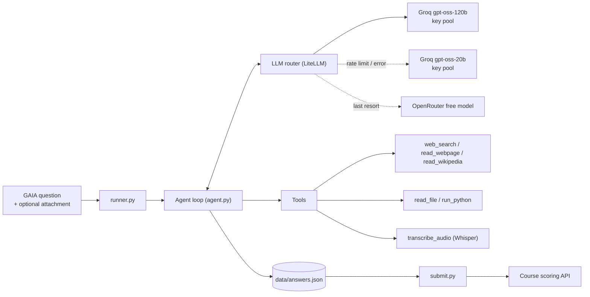
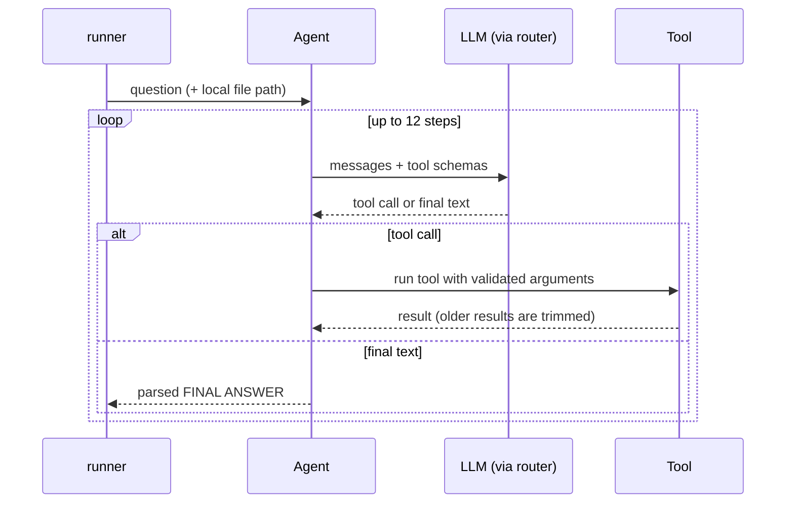

# GAIA Agent

A small, framework-free **tool-using LLM agent** built for the final project (Unit 4) of the
[Hugging Face Agents Course](https://huggingface.co/learn/agents-course). It answers questions from a subset of the
[GAIA benchmark](https://huggingface.co/datasets/gaia-benchmark/GAIA) (web research, Wikipedia history, PDFs,
spreadsheets, Python files and audio) using only **free-tier LLM APIs**.

**Result:** 85% (17/20) on the course's scoring API, well above the 30% needed for the certificate.


## Highlights

- **Own agent loop (~150 lines)** on top of native OpenAI-style tool calling: no agent framework, so every step is visible in the logs.
- **Resilient LLM layer:** a [LiteLLM](https://github.com/BerriAI/litellm) `Router` rotates over several API keys, falls back from Groq to OpenRouter, and waits and retries when every deployment is rate limited.
- **Six tools:** web search, web page / PDF reader, Wikipedia reader with *historical revisions*, file reader, Python runner, local Whisper transcription.
- **Token-aware web reading:** pages are converted to Markdown without loss, split by headings, and only the sections that match the question are sent to the model.
- **Exact-match friendly:** the model must end with `FINAL ANSWER: ...`; the answer is parsed and normalised before storing.
- **Answer store:** answers are kept in `data/answers.json`; failed or `UNKNOWN` runs never overwrite a good answer.

## Architecture



### Agent loop



### How web pages are read


## Tools

| Tool | What it does |
|---|---|
| `web_search` | DuckDuckGo search with backend retries; filters ads and sources that only mirror benchmark questions. |
| `read_webpage` | Fetches an HTML page or PDF, converts it to Markdown and returns the sections that match the `question` argument. |
| `read_wikipedia` | Reads an English Wikipedia article through the MediaWiki API, optionally **as of a date** (for "2022 version" style questions). |
| `read_file` | Previews spreadsheets, CSV, PDF and text/code files. |
| `run_python` | Runs a snippet or an attached `.py` file in a subprocess (API keys are removed from its environment). |
| `transcribe_audio` | Local [Whisper](https://github.com/openai/whisper) transcription (GPU if available). |

## Quick start

### Requirements

- Linux or macOS with Python 3.12+ and [uv](https://docs.astral.sh/uv/)
- `ffmpeg` (Whisper); an NVIDIA GPU is optional but speeds up transcription
- Optional: `tesseract-ocr` for scanned PDFs
- Free API keys from [Groq](https://console.groq.com) and [OpenRouter](https://openrouter.ai)
- A Hugging Face account that has accepted the terms of the gated [GAIA dataset](https://huggingface.co/datasets/gaia-benchmark/GAIA) (needed to download question attachments)

### Install

```bash
git clone https://github.com/<your-user>/gaia-agent.git
cd gaia-agent
sudo apt install -y ffmpeg          # Ubuntu / Debian
uv sync
cp .env.example .env                # then fill in your keys
```

### Configuration (`.env`)

| Variable | Purpose |
|---|---|
| `GROQ_API_KEY_1` ... `GROQ_API_KEY_5` | Groq keys (any number, 1 to 5). |
| `OPENROUTER_API_KEY_1` ... `OPENROUTER_API_KEY_5` | OpenRouter keys, used as the last fallback. |
| `GROQ_MODEL`, `GROQ_MODEL_2`, `OPENROUTER_MODEL` | Model IDs in LiteLLM format. Provider catalogs change often, so check them first. |
| `HF_USERNAME` | Your Hugging Face username (used when submitting). |
| `HF_TOKEN` | Read-only Hugging Face token for downloading GAIA attachments. |
| `EMAIL` | Contact address placed in the HTTP User-Agent (Wikimedia policy). |
| `WHISPER_MODEL` | Whisper size, default `small`. |

> Keys from the **same provider account usually share one quota**, so rotating several keys of one account does not multiply your limits.

## Usage

```bash
# 1. Check that every API key works (with tool calling)
uv run python -m src.healthcheck

# 2. Run the agent on selected questions
uv run python -m src.runner --only 1,3,6 --preview 300

# 3. Run only the questions that have no good stored answer yet
uv run python -m src.runner --missing

# 4. Inspect what the agent would read from a page
uv run python -m src.peek https://arxiv.org/pdf/2306.01071 "acknowledgments NASA award"

# 5. Review the payload, then submit
uv run python -m src.submit --code-url https://github.com/<your-user>/gaia-agent --dry-run
uv run python -m src.submit --code-url https://github.com/<your-user>/gaia-agent
```

| `runner` flag | Meaning |
|---|---|
| `--only 1,3,5` | Run only these 1-based question numbers. |
| `--limit N` | Run at most N questions. |
| `--skip-files` | Skip questions with attachments. |
| `--missing` | Skip questions that already have a good stored answer. |
| `--preview N` | Characters of each tool result to print (default 200). |
| `--quiet` | Hide per-step tool logs. |
| `--refresh` | Re-download the question list. |

Re-running a question replaces its stored answer, so re-run selectively.

## Project structure

```text
.
├── src/
│   ├── agent.py          # agent loop, system prompt, answer parsing
│   ├── llm_router.py     # LiteLLM router: key pools, fallbacks, rate-limit retry
│   ├── runner.py         # CLI: fetch questions, run the agent, store answers
│   ├── submit.py         # CLI: send stored answers to the scoring API
│   ├── api_client.py     # questions + attachment download (GAIA dataset, API fallback)
│   ├── store.py          # data/answers.json handling
│   ├── healthcheck.py    # per-key API check
│   ├── peek.py           # debug helper: what does read_webpage return?
│   └── tools/
│       ├── base.py       # tool schema helper
│       ├── web.py        # search, web/PDF reader, Wikipedia reader
│       ├── files.py      # read_file, run_python
│       └── audio.py      # Whisper transcription
├── docs/
│   └── demo.tape         # script that records docs/demo.gif (VHS)
├── .env.example
└── README.md
```

`data/` (questions, downloaded attachments, stored answers, logs) and `.env` are git-ignored.

## Design decisions and lessons learned

- **No agent framework.** A plain loop over native tool calling was easier to debug than an abstraction layer: when a model printed a tool call as text, or a provider rejected an unknown field, the cause was visible immediately.
- **Silent fallbacks hide failures.** A deprecated Groq model made every request fall back to OpenRouter without any error, so the whole system ran slowly and burned the free daily quota. The step log now prints the model used for each call.
- **Sanitise assistant messages.** Messages are rebuilt to the fields every provider accepts. Provider-specific extras made Groq reject history produced by another provider.
- **Lossless conversion beats clever extraction.** The first "main content" extractor silently dropped tables, and a small local model hallucinated page text. Converting everything to Markdown and selecting sections by keyword is simple and never invents content.
- **Treat search results as evidence only when they come from primary sources.** Crossword and puzzle sites that mirror benchmark questions are blocked.
- **The course's `/files/{task_id}` endpoint returned 404.** Attachments are downloaded from the gated GAIA dataset instead.
- **Cap the context.** Older tool results are truncated and decoding is deterministic, which keeps token usage and run-to-run variance down on free tiers.

## Limitations

- No vision or video tool yet, so image and video questions are answered with `UNKNOWN` (for example the chess position and the YouTube bird-count question).
- Answers can still vary between runs when a question allows several valid readings (for example how to phrase an ingredient list).
- Free tiers have strict per-minute and per-day limits; a full run can pause while waiting.
- `run_python` executes model-written code with your user's permissions and is **not a sandbox**. Use a container before running it on anything sensitive.
- Section selection is keyword-based, so a question that shares no words with the target section may need a second, rephrased lookup.

## Notes on the benchmark data

GAIA validation questions and files are gated and should not be redistributed. This repository contains **no benchmark files and no answers**; `data/` is created locally when you run the project.

## Acknowledgements

- [Hugging Face Agents Course](https://huggingface.co/learn/agents-course) and the [GAIA benchmark](https://huggingface.co/datasets/gaia-benchmark/GAIA)
- [LiteLLM](https://github.com/BerriAI/litellm), [OpenAI Whisper](https://github.com/openai/whisper), [PyMuPDF](https://pymupdf.readthedocs.io), [markdownify](https://github.com/matthewwithanm/python-markdownify)

## License

Add a license file of your choice (for example MIT) before publishing.
